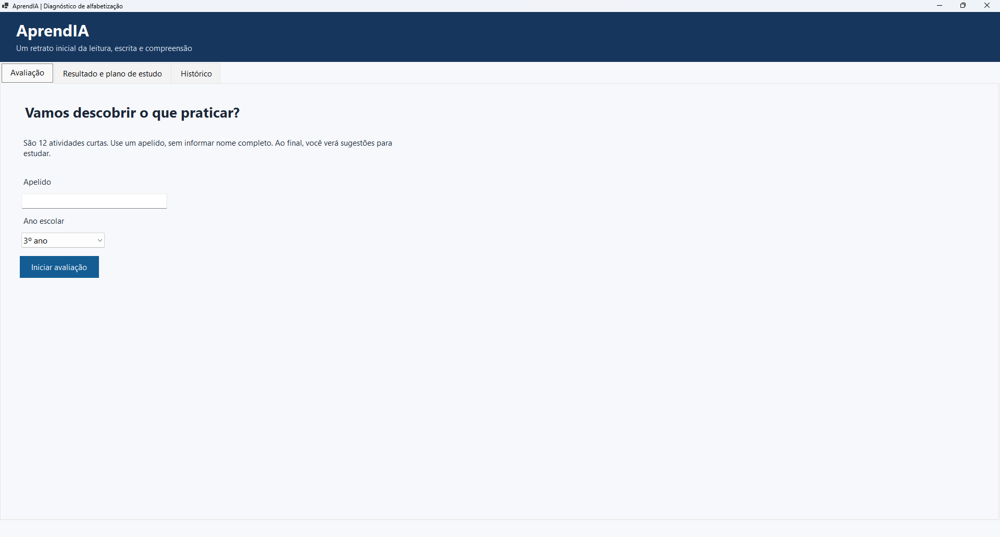
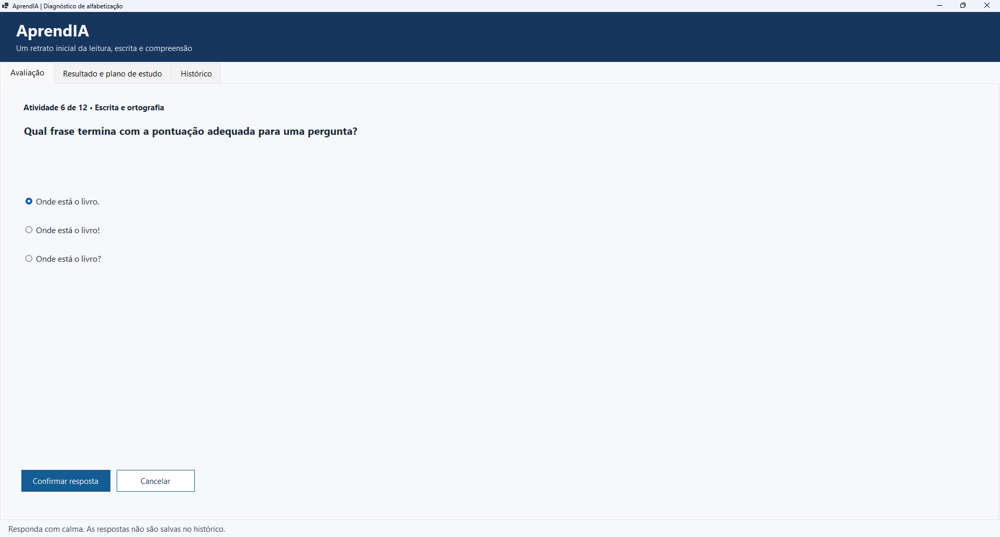
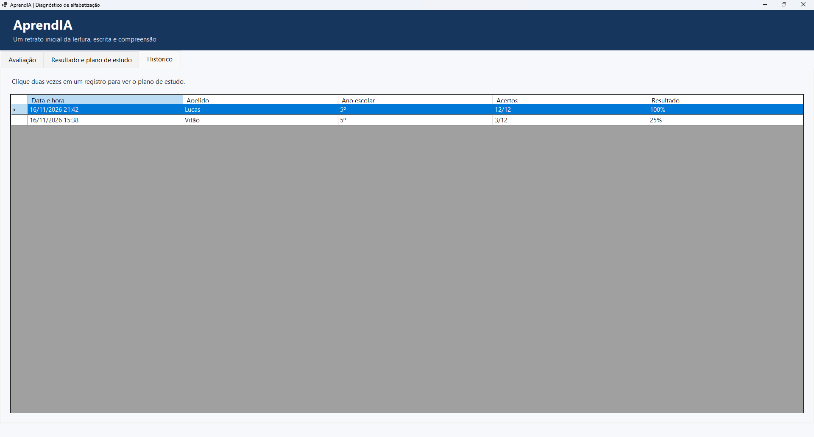
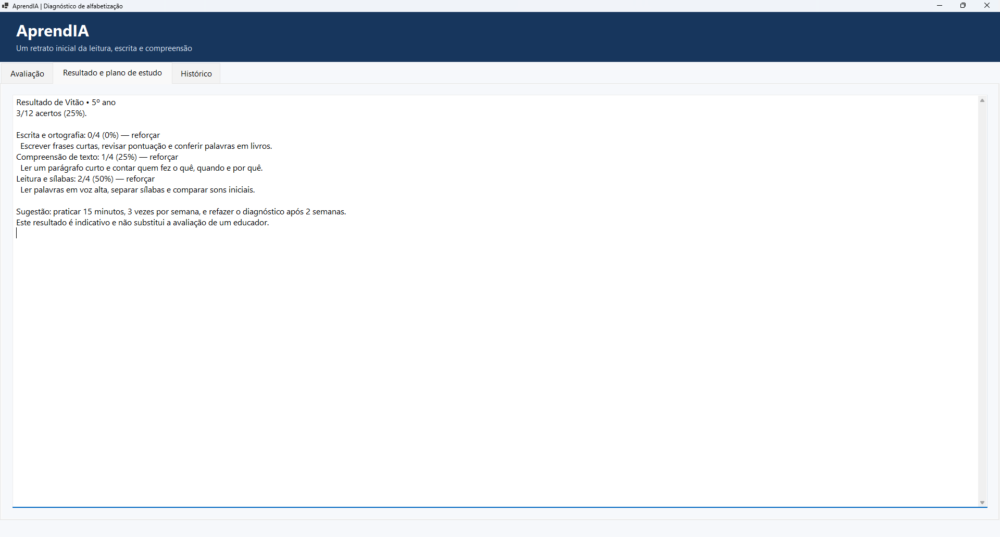

# Evidências de funcionamento — AprendIA

## Verificações executadas

```text
dotnet build CitizenTech/AprendIA.csproj -c Release
Build succeeded.
0 Warning(s)
0 Error(s)

dotnet run --project CitizenTech.Smoke/CitizenTech.Smoke.csproj -c Release
Diagnóstico simulado: 12 questões, 8 acertos.
Lacuna identificada: Escrita e ortografia.
Histórico JSON: gravação e leitura verificadas.
RESULTADO: OK
```

## Capturas da interface

### Tela inicial

Identificação do aplicativo, apelido, ano escolar e início da avaliação.



### Questão em andamento

Atividade 6 de 12, alternativas e ações de confirmar ou cancelar.



### Histórico

Lista de duas avaliações de exemplo.



### Plano de estudo

Resultado de exemplo com 3 acertos em 12 atividades e sugestões por habilidade.


